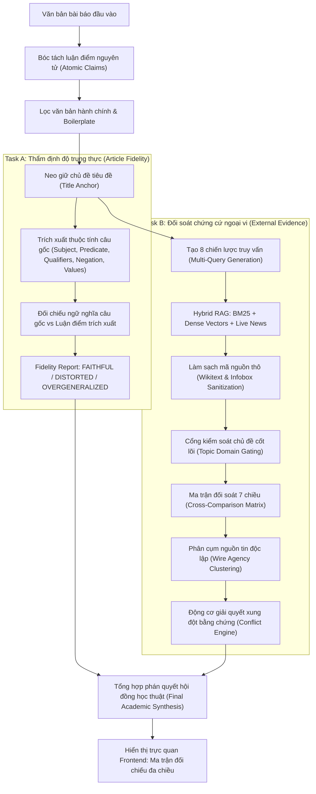

# TRUSTMEDIA AI — ARTICLE CLAIM vs EXTERNAL EVIDENCE CROSS-VERIFICATION ARCHITECTURE

## 1. Executive Summary

Module **Article Claim vs External Evidence Cross-Verification** là thành phần cốt lõi trong hệ thống TrustMedia AI. Nhiệm vụ tối thượng của module là thiết lập cơ chế **thẩm định kép (Dual-Core Verification Pipeline)** nhằm giải quyết dứt điểm các hiện tượng:
1. Trích xuất sai lệch ngữ nghĩa (Semantic Distortion), khái quát hóa quá đà (Overgeneralization) hoặc đánh tráo khái niệm so với câu gốc trong bài báo.
2. Trích xuất nhầm các đoạn văn bản hành chính / giao diện báo chí (bylines, contact, copyright, masthead, mạng xã hội) thành các luận điểm sự kiện cần kiểm chứng.
3. RAG truy vấn bằng chứng ngoại vi bị lạc đề (Off-topic retrieval), nhặt nhầm các bảng thông tin thô (raw wikitext infoboxes) từ Wikipedia không liên quan đến chủ đề bài báo.
4. Đưa ra phán quyết thiếu căn cứ hoặc ép buộc nhãn (Hallucinated verdict) khi dữ liệu bên ngoài không đủ thông tin xác thực.

Hệ thống phân tách quy trình kiểm chứng thành hai trục độc lập:
- **Trục A (Article Fidelity Verification):** Đối soát giữa câu văn gốc trong bài báo và luận điểm nguyên tử được bóc tách.
- **Trục B (External Evidence Verification):** Đối soát đa chiều giữa luận điểm bài báo và bằng chứng độc lập ngoại vi thông qua ma trận thuộc tính (Attribute Comparison Matrix), phân cụm nguồn độc lập và động cơ giải quyết xung đột bằng chứng.

---

## 2. Core Architecture & Verification Flow



---

## 3. Atomic Claim Decomposition & Attribute Extraction Schema

Mọi luận điểm trong bài báo đều được phân rã thành các bộ thuộc tính có cấu trúc thông qua `ClaimArticleAligner` (`backend/app/services/claim_article_aligner.py`):

```python
@dataclass
class ClaimAttributes:
    claim_text: str                     # Toàn văn luận điểm
    subject: str | None                 # Thực thể chủ từ (Subject Entity)
    predicate: str | None               # Vị ngữ / Hành động
    object: str | None                  # Đối tượng chịu tác động
    value: float | None                 # Số liệu định lượng
    unit: str | None                    # Đơn vị tính (%, tỷ đồng, USD, ...)
    time: str | None                    # Mốc thời gian (ngày, tháng, năm)
    location: str | None                # Địa danh / Địa lý thực thể
    modality: str                       # Ngữ khí: "asserted", "possible", "reported"
    causal_relation: bool               # Quan hệ nhân quả (True) vs Tương quan (False)
    attribution: str | None             # Cơ quan / Người phát ngôn nguồn
    claim_type: str                     # FACTUAL_CLAIM, STATISTICAL_CLAIM, SCIENTIFIC_CLAIM
    negation: bool                      # Trạng thái phủ định (True/False)
    qualifiers: list[str]               # Điều kiện ràng buộc ("in-vitro", "trên chuột", ...)
```

---

## 4. Task A: Article Fidelity Verification Engine

Module `ClaimArticleAligner.verify_article_fidelity` kiểm tra 8 phương diện sai lệch ngữ nghĩa giữa câu gốc và luận điểm trích xuất:

| Loại sai lệch ngữ nghĩa | Cơ chế phát hiện | Hành động & Trừ điểm |
| :--- | :--- | :--- |
| **NEGATION_REVERSAL** | Đảo ngược từ phủ định ("không", "chưa", "chẳng") | Đánh dấu `DISTORTED`, trừ 0.50 điểm, cảnh báo nghiêm trọng |
| **CAUSAL_DISTORTION** | Biến liên hệ tương quan thành quan hệ nhân quả tuyệt đối | Đánh dấu `DISTORTED`, trừ 0.35 điểm |
| **MODALITY_EXAGGERATION**| Biến khả năng/dự kiến ("có thể", "tiềm năng") thành khẳng định 100% | Đánh dấu `DISTORTED`, trừ 0.25 điểm |
| **NUMERICAL_DISTORTION** | Thay đổi giá trị số học hoặc hoán đổi đơn vị đo lường | Đánh dấu `DISTORTED`, trừ 0.40 điểm |
| **NUMERICAL_OMISSION**   | Lược bỏ số liệu định lượng cốt lõi trong câu gốc | Trừ 0.20 điểm |
| **TEMPORAL_DISTORTION**  | Dịch chuyển hoặc làm sai lệch mốc thời gian sự kiện | Trừ 0.25 điểm |
| **OVERGENERALIZATION**   | Lược bỏ điều kiện thử nghiệm ("in-vitro", "trên chuột bạch") để gán cho người | Đánh dấu `OVERGENERALIZED`, trừ 0.30 điểm |
| **ATTRIBUTION_OMISSION** | Cắt bỏ nguồn phát ngôn, biến ý kiến cá nhân thành sự thật khách quan | Trừ 0.15 điểm |

---

## 5. Task B: External Evidence Verification Pipeline

### 5.1. Wikitext Infobox & Markup Sanitization
Để ngăn chặn tình trạng hiển thị văn bản thô rác (`| territory2 = | length = 4.209,3 km...`), hàm `clean_wikitext` (`backend/app/services/hybrid_retrieval.py`) thực hiện lọc đệ trình 4 tầng:
- Gỡ bỏ thẻ ref: `<ref>...</ref>`, `<ref />`.
- Gỡ bỏ bảng biểu MediaWiki: `{| ... |}`.
- Gỡ bỏ toàn bộ hộp thông tin (infobox templates): `{{ ... }}`.
- Chuyển đổi liên kết nội bộ `[[Target|Label]]` -> `Label`.

### 5.2. Strict Topic Domain Gating
Ngăn chặn hiện tượng BM25 ghép từ địa lý ngẫu nhiên ("Trung Quốc", "phía đông"):
- Hệ thống thiết lập danh mục loại trừ `GENERIC_AND_GEO_TERMS` bao gồm các từ dừng địa lý và từ nhận thức ("tìm", "thấy", "tỉnh", "phía", "hôm").
- Tài liệu kiểm chứng bắt buộc phải chứa các từ khóa chủ đề chuyên môn (Substantive domain tokens) với tỷ lệ tối thiểu `max(2, int(len(tokens) * 0.30))` trước khi được đưa vào đối soát chi tiết.

### 5.3. Attribute Comparison Matrix (Ma trận Đối soát 7 chiều)
Module `EvidenceCrossComparator` (`backend/app/services/evidence_cross_comparator.py`) so khớp song song 7 thuộc tính:
1. **Thực thể chính (Subject Entity):** So sánh `claim_attrs.subject` vs `evidence_text`.
2. **Địa điểm thực thể (Location Entity):** Phát hiện sai lệch địa phương (ví dụ: Hà Nội vs Hưng Yên).
3. **Số liệu & Thống kê (Numerical):** So sánh giá trị số và đơn vị đo lường.
4. **Mốc thời gian (Temporal):** So sánh năm, tháng, khoảng thời gian.
5. **Quan hệ nhân quả & Khẳng định (Causality / Modality):** Đối chiếu tương quan vs nhân quả dứt khoát.
6. **Thuộc tính phủ định (Negation):** Kiểm tra sự đồng thuận về tính khẳng định/phủ định.
7. **Bối cảnh & Điều kiện (Context & Qualifiers):** Đánh giá khoảng trống lâm sàng / bằng chứng.

Trạng thái khớp được phân loại chính xác: `MATCH`, `PARTIAL`, `MISMATCH`, `NOT_MENTIONED`, `EXAGGERATED`.

---

## 6. Source Independence Clustering & Conflict Resolution

### 6.1. Phân cụm nguồn tin (Wire Syndication Clustering)
Nhiều tờ báo dẫn lại cùng một bản tin từ cơ quan thông tấn (ví dụ TTXVN, Reuters, AFP) không thể được tính là nhiều bằng chứng độc lập.
Hệ thống nhận diện các bản tin dẫn nguồn và gom về một cụm duy nhất:
- `WireCluster_Thông tấn xã Việt Nam (TTXVN)`
- `WireCluster_Hãng tin Reuters`
- `WireCluster_Hãng tin AFP`
- `Domain_{hostname}` cho các cơ quan nghiên cứu độc lập.

### 6.2. Động cơ giải quyết xung đột (Conflict Engine)
Khi tồn tại đồng thời nguồn xác nhận (`SUPPORTS`) và nguồn bác bỏ (`CONTRADICTS`) từ các cụm độc lập:
- Tạo một bản ghi trong `conflict_matrix`: ghi nhận rõ `Nguồn A vs Nguồn B`, lý do mâu thuẫn.
- Phán quyết chuyển về trạng thái **`CONFLICTING_EVIDENCE`**.
- Không áp đặt phán quyết một chiều khi chưa có sự đồng thuận giữa các cơ quan khoa học.

---

## 7. Interactive Frontend Presentation

Tại giao diện người dùng `frontend/src/pages/FactCheckingPage.tsx`:
1. **Hộp thông tin Article Fidelity:** Hiển thị ngay dưới phát ngôn bài báo, gắn nhãn xanh (`Khớp nguyên văn bài báo`) hoặc đỏ (`Sai lệch ngữ nghĩa bài báo`), kèm phân tích chi tiết các điểm sai lệch.
2. **Bảng Ma trận Đối soát Đa chiều:** Render bảng chuẩn hóa gồm 5 cột:
   - `Thuộc tính đối soát`
   - `Phát ngôn bài báo`
   - `Bằng chứng đối chiếu`
   - `Trạng thái khớp` (Badge: KHỚP, SAI LỆCH, MỘT PHẦN, CHƯA NÊU)
   - `Ghi chú đối soát`
3. **Cảnh báo Xung đột Bằng chứng (Conflicting Evidence Banner):** Nổi bật với viền đỏ khi có sự bất đồng giữa các cơ quan kiểm chứng độc lập.
4. **Độ tin cậy toàn bài & Khuyến nghị:** Tính toán theo công thức chuẩn hóa, kết luận rõ ràng:
   - `ĐỘ TIN CẬY CAO` (NÊN TIN CẬY)
   - `ĐỘ TIN CẬY TRUNG BÌNH` (THAM KHẢO CÓ CHỌN LỌC)
   - `KHÔNG NÊN TIN CẬY` (CẢNH BÁO SAI SỰ THẬT)
