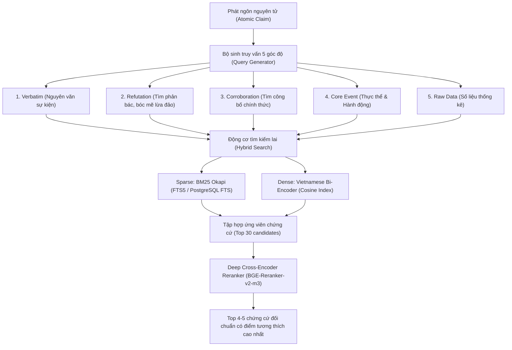

# THIẾT KẾ BỘ TRUY XUẤT CHỨNG CỨ ĐA TẦNG (EVIDENCE RETRIEVAL ENGINE)
**Chiến lược Dual-Query, Hybrid Search (Dense + Sparse) và Reranking sâu**

---

## 1. NGUYÊN TẮC THIẾT KẾ BỘ TRUY XUẤT

Một hệ thống kiểm chứng sự thật không thể chỉ tìm kiếm bằng từ khóa nguyên văn, vì việc đó dẫn đến **Confirmation Bias (Thiên kiến xác nhận)** — chỉ tìm thấy những bài viết lặp lại tin đồn ban đầu.

TrustMedia AI áp dụng 3 nguyên tắc truy xuất:
1. **Truy xuất đối lập 2 chiều (Adversarial Dual-Query Strategy):** Luôn sinh cả truy vấn tìm tài liệu ủng hộ và truy vấn tìm tài liệu bác bỏ/đính chính.
2. **Tìm kiếm lai kết hợp (Hybrid Dense-Sparse RAG):** Kết hợp khả năng khớp từ khóa chính xác của BM25 với khả năng hiểu ngữ nghĩa sâu của Bi-Encoder.
3. **Phân cấp nguồn tin thực nghiệm (Hierarchical Knowledge Gating):** Ưu tiên cao nhất cho dữ liệu đối chuẩn chính thức (ViFactCheck, ViWiki, X-FACT, FEVER), sau đó mới tới mạng lưới tin tức báo chí thời sự.

---

## 2. KIẾN TRÚC BỘ TRUY XUẤT LAI (HYBRID RETRIEVAL ARCHITECTURE)

---

## 3. CÔNG THỨC KẾT HỢP ĐIỂM SỐ LAI (HYBRID RECIPROCAL RANK FUSION)

Điểm số của từng đoạn văn bản chứng cứ $d$ được tính toán qua phương pháp RRF kết hợp điểm ngữ nghĩa:

$$Score_{hybrid}(d) = \alpha \cdot \frac{1}{k + Rank_{BM25}(d)} + (1 - \alpha) \cdot CosineSim(E_{bi}(q), E_{bi}(d))$$

Trong đó:
- $k = 60$ (hệ số làm mịn thứ hạng RRF).
- $\alpha = 0.45$ (trọng số cân bằng giữa khớp từ khóa chính xác và tương đồng ngữ nghĩa).
- Điểm sau đó được chuẩn hóa và đưa qua Cross-Encoder $CrossScore(claim, d)$ với ngưỡng kích hoạt tối thiểu $\ge 0.35$.

---

## 4. CHIẾN LƯỢC GOM CỤM NGUỒN VÀ PHÁT HIỆN SAO CHÉP THÔNG TẤN (SOURCE CLUSTERING)

Khi một tin tức được hãng thông tấn (như TTXVN, Reuters, AP) phát đi, hàng chục tờ báo có thể đăng lại nguyên văn. Nếu hệ thống đếm mỗi bài báo là một nguồn độc lập, một tin đồn thất thiệt được nhiều báo lá cải copy lại sẽ bị coi là "nhiều nguồn xác thực".

**Giải pháp:**
- Thuật toán MinHash / N-gram Fingerprinting phát hiện các bài báo có độ trùng lặp văn bản $> 80\%$.
- Nhóm các bài báo sao chép vào cùng một **Source Dependency Group**.
- Chỉ số `independent_sources_count` chỉ tăng khi chứng cứ đến từ các tổ chức báo chí có ban biên tập độc lập và nội dung điều tra riêng biệt.

