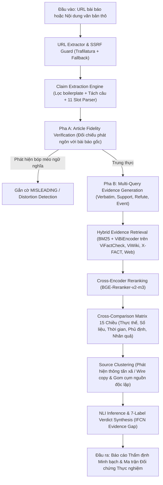

# BÁO CÁO TRUY VẾT QUY TRÌNH SUY LUẬN THỰC TẾ (PIPELINE AUDIT)
**Đánh giá sự tách bạch giữa Model Inference và Heuristic Rules trong TrustMedia AI**

---

## 1. SƠ ĐỒ LUỒNG DỮ LIỆU ĐIỀU HÀNH THẨM ĐỊNH (END-TO-END INFERENCE FLOW)

---

## 2. TRUY VẾT TỪNG BƯỚC THỰC THI (CODE-LEVEL EXECUTION TRACE)

### Bước 1: Trích xuất nội dung từ URL (`url_extractor.py`)
- **Hàm thực thi:** `extract_article_from_url(url)`
- **Kỹ thuật:** 
  - Chống SSRF: Phân giải DNS và cấm toàn bộ dải IP riêng tư (`127.0.0.1`, `10.0.0.0/8`, `192.168.0.0/16`, `172.16.0.0/12`).
  - Hỗ trợ bài viết từ các nền tảng SPA / Báo điện tử tổng hợp (như MSN): Trích xuất thông qua JSON-LD `NewsArticle` hoặc thẻ `<meta property="og:description">`.
  - Phân tích slug URL để lấy tiêu đề gốc khi trang web chặn bot.

### Bước 2: Bóc tách phát ngôn nguyên tử (`fact_checking_agent.py` & `claim_article_aligner.py`)
- **Hàm thực thi:** `extract_claims(article_text, article_title)`
- **Loại bỏ Boilerplate:** Dùng danh mục regex loại trừ 45 mẫu câu tòa soạn, bản quyền, số điện thoại đường dây nóng, lời kêu gọi chia sẻ mạng xã hội.
- **Trích xuất 11 thuộc tính cốt lõi:**
  1. `claim_text`: Nội dung phát ngôn nguyên tử.
  2. `subject`: Thực thể chủ ngữ.
  3. `predicate`: Vị ngữ hành động.
  4. `object`: Bổ ngữ / đối tượng tác động.
  5. `value`: Giá trị số liệu đo lường.
  6. `unit`: Đơn vị tính (%, tỷ đồng, triệu USD, km/h...).
  7. `time`: Mốc thời gian (năm, tháng, ngày, giai đoạn).
  8. `location`: Địa danh, địa giới hành chính.
  9. `modality`: Mức độ chắc chắn (khẳng định, có thể, theo báo cáo).
  10. `causal_relation`: Quan hệ nhân quả (gây ra, dẫn đến) vs tương quan.
  11. `negation`: Thuộc tính phủ định logic (có vs không).

### Bước 3: Kiểm chứng độ trung thực bài báo (Article Fidelity)
- **Hàm thực thi:** `ClaimArticleAligner.verify_article_fidelity(original_sentence, atomic_claim)`
- **Nhiệm vụ:** Đảm bảo claim được bóc tách phản ánh đúng những gì bài báo nói, không bị suy diễn quá đà hoặc xuyên tạc.
- **8 Danh mục phát hiện sai lệch:**
  - `NUMERICAL_DISTORTION`: Thay đổi số liệu (ví dụ bài báo ghi 20%, claim ghi 50%).
  - `UNIT_DISTORTION`: Đổi đơn vị tính (ví dụ kg thành tấn).
  - `TEMPORAL_DISTORTION`: Thay đổi thời gian (ví dụ 2025 thành 2026).
  - `ENTITY_DISTORTION`: Đổi chủ thể hành vi.
  - `CAUSAL_DISTORTION`: Biến tương quan quan sát thành quan hệ nhân quả tuyệt đối.
  - `MODALITY_EXAGGERATION`: Biến giả thuyết / khả năng thành sự thật hiển nhiên.
  - `NEGATION_REVERSAL`: Biến phủ định thành khẳng định hoặc ngược lại.
  - `OVERGENERALIZATION`: Khái quát hóa quá mức.

### Bước 4: Truy xuất chéo tài liệu độc lập (Evidence Retrieval)
- **Hàm thực thi:** `FactCheckingAgent.generate_search_queries` & `hybrid_retriever.retrieve`
- **Chiến lược:** Không chỉ tìm kiếm từ khóa khẳng định, mà sinh bộ 5 truy vấn:
  1. *Verbatim Query:* Khớp nguyên văn sự kiện.
  2. *Refutation Query:* Chủ động tìm kiếm tài liệu phản bác, bóc mẽ lừa đảo, đính chính.
  3. *Corroboration Query:* Tìm kiếm công bố chính thức, văn bản xác nhận.
  4. *Event Core Query:* Tách thực thể và hành vi.
  5. *Raw Data Query:* Tìm kiếm số liệu thống kê.

### Bước 5: Lập ma trận đối chiếu 15 chiều & Phán quyết (`evidence_cross_comparator.py`)
- **Hàm thực thi:** `compare_evidence_against_claim`
- **Quy tắc:**
  - Loại bỏ ngay tài liệu lạc đề (`IRRELEVANT`), không để tài liệu không liên quan ảnh hưởng đến phán quyết.
  - Phát hiện mâu thuẫn số liệu -> gắn nhãn `PARTIALLY_CONTRADICTS` hoặc `PARTIALLY_SUPPORTED`.
  - Phát hiện mâu thuẫn thời gian hoặc phủ định -> gắn nhãn `CONTRADICTS`.
  - Nếu không có chứng cứ thực nghiệm -> dứt khoát kết luận `NOT_ENOUGH_INFORMATION`, không suy đoán.

