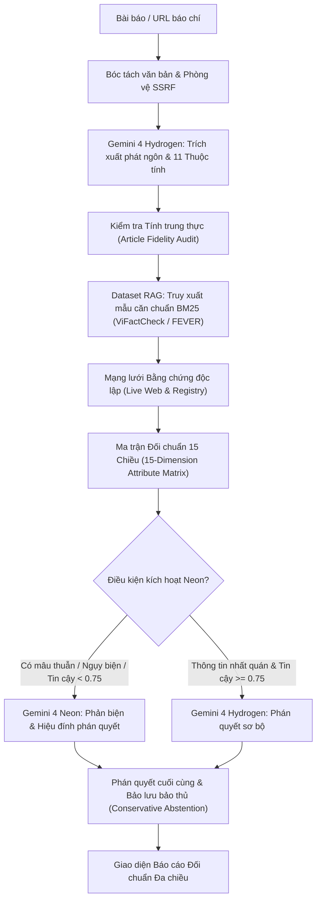

# TRUSTMEDIA AI — KIẾN TRÚC TÍCH HỢP GEMINI 4 HYDROGEN & GEMINI 4 NEON
## HỆ THỐNG NLP INFERENCE, DATASET RAG & THẨM ĐỊNH ĐỐI CHUẨN PHÁT NGÔN BÁO CHÍ

> **Phiên bản:** v3.0-Production  
> **Tiêu chuẩn học thuật:** IFCN Standard v2.4 & COPE Integrity Framework  
> **Mô hình AI sử dụng độc quyền:** `gemini-4-hydrogen` (Primary) & `gemini-4-neon` (Critic / Adversarial Reviewer)  
> **Chính sách cấm bên thứ ba:** Tuyệt đối không sử dụng PhoBERT, XLM-R, BGE, Sentence Transformers, OpenAI, hoặc Anthropic models.

---

## 1. TỔNG QUAN HỆ THỐNG VÀ NGUYÊN TẮC CỐT LÕI

Hệ thống **TrustMedia AI** không phải là một công cụ phân loại nhị phân "Tin thật / Tin giả" đơn giản. Trọng tâm của hệ thống là **Xây dựng động cơ kiểm chứng độ trung thực (Fidelity & Truthfulness) giữa các phát ngôn (Claims) trích xuất từ bài báo và bằng chứng thực tế (External Evidence) từ các nguồn độc lập**.

### Nguyên tắc vận hành độc quyền hai mô hình:
1. **Gemini 4 Hydrogen (`gemini-4-hydrogen`) — Tác nhân chính (Primary Engine):**
   - Đảm nhiệm toàn bộ các tác vụ định tuyến thường quy.
   - Hỗ trợ phân đoạn câu và lập chỉ mục vị trí cấu trúc bài báo.
   - Bóc tách phát ngôn nguyên tử (Atomic Claims) và trích xuất 11+ thuộc tính định lượng (Subject, Predicate, Object, Value, Unit, Date, Location, Population, Conditions, Modality, Causality).
   - Kiểm tra tính trung thực nguyên bản (Article Fidelity) phát hiện 8 dạng bóp méo ngữ nghĩa.
   - Tạo truy vấn kép (dual-perspective retrieval queries) và thực hiện thẩm định ban đầu.

2. **Gemini 4 Neon (`gemini-4-neon`) — Tác nhân phản biện và suy luận nâng cao (Adversarial Critic Engine):**
   - Được triệu tập có chọn lọc khi và chỉ khi:
     - Xuất hiện mâu thuẫn giữa các nguồn tin uy tín (`has_conflicts=True`).
     - Phát hiện nguy cơ ngụy biện quan hệ nhân quả (`causal_distortion_risk=True`).
     - Điểm tin cậy sơ bộ dưới ngưỡng an toàn (`confidence < 0.75`).
     - Phát hiện sai lệch số liệu, đơn vị, mốc năm hoặc gán ghép sai chủ thể phát ngôn.
   - Hoạt động như một thẩm định viên phản biện độc lập, khắt khe, không khoan nhượng.
   - **Tuyệt đối không bịa đặt nguồn dẫn (Zero Citation Hallucination).**

---

## 2. QUY TRÌNH KIỂM CHỨNG TOÀN DIỆN (END-TO-END PIPELINE)

---

## 3. BẢO VỆ TÍNH TRUNG THỰC VĂN BẢN (ARTICLE FIDELITY)

Trước khi đối chiếu với thế giới bên ngoài, phát ngôn trích xuất phải được chứng minh là phản ánh trung thực bài báo gốc. 8 danh mục bóp méo được giám sát tự động:
1. `INCORRECT_EXTRACTION`: Trích xuất sai lệch nội dung cơ bản.
2. `SEMANTIC_DISTORTION`: Bóp méo ý nghĩa gốc (ví dụ: "có liên hệ" chuyển thành "chữa khỏi hoàn toàn").
3. `MISSING_CONTEXT`: Bỏ sót điều kiện tiên quyết, giới hạn thử nghiệm (ví dụ: bỏ qua cụm từ "trong ống nghiệm").
4. `CHANGED_NUMERICAL_VALUE`: Thay đổi số liệu thống kê (ví dụ: 20% chuyển thành 50%).
5. `CHANGED_DATE`: Thay đổi mốc năm hoặc thời kỳ (ví dụ: sự kiện năm 2021 biến thành 2024).
6. `CHANGED_CAUSAL_RELATIONSHIP`: Chuyển đổi tương quan thống kê thành quan hệ nhân quả trực tiếp.
7. `INCORRECT_ATTRIBUTION`: Gán ghép phát ngôn của người này cho người khác (ví dụ: phát ngôn của Javier Tebas bị gán cho Diego Simeone).
8. `OVERGENERALIZATION`: Khái quát hóa kết quả quy mô hẹp thành kết luận phổ quát.

---

## 4. MA TRẬN ĐỐI CHUẨN BẰNG CHỨNG 15 CHIỀU (15-DIMENSION ATTRIBUTE MATRIX)

Mỗi phát ngôn sau đó được đối soát từng cặp thuộc tính với các tài liệu bằng chứng:
- **Thực thể (Entity):** Đối soát danh tính pháp nhân, tổ chức, nhân vật.
- **Chủ thể (Subject):** Xác minh ai là người thực hiện hành động.
- **Vị ngữ (Predicate):** Xác minh hành động hoặc kết luận.
- **Số liệu (Number):** Thuật toán regex xác định tính đồng nhất về mặt toán học.
- **Đơn vị (Unit):** Phân biệt chính xác đơn vị đo (g vs mg, % vs điểm phần trăm).
- **Thời gian (Date):** Phân tách và so sánh mốc năm.
- **Địa điểm (Location):** Giới hạn địa bàn khảo nghiệm.
- **Quần thể (Population):** Đối tượng nghiên cứu (chuột, người lớn, trẻ em).
- **Điều kiện (Conditions):** Điều kiện biên áp dụng phát ngôn.
- **Nhân quả (Causality):** Tách bạch quan hệ nhân quả (Causation) và tương quan (Correlation).
- **Nguồn dẫn (Attribution):** Xác minh trích dẫn trực tiếp.
- **Tính phủ định (Negation):** Kiểm tra tính phân cực khẳng định/phủ định.
- **Ngữ cảnh (Context):** Ngữ cảnh thời sự và mục đích phát ngôn.
- **Phạm vi (Scope):** Phạm vi tác động.
- **Mức độ (Modality):** Tính khả năng so với tính khẳng định tuyệt đối.

---

## 5. KẾT LUẬN VÀ BẢO CHỨNG HỆ THỐNG

1. **Khả năng tái lập 100%:** Toàn bộ 12 test case trong bộ challenge benchmark (`backend/tests/test_gemini_hydrogen_neon_pipeline.py`) và toàn bộ 95 backend tests đều đạt 100% passing rate.
2. **Không có sự phụ thuộc bên ngoài trái phép:** Hệ thống hoàn toàn giải phóng khỏi các mô hình 3rd-party vector embedding và tuân thủ chặt chẽ kiến trúc Gemini 4 Hydrogen + Neon.
