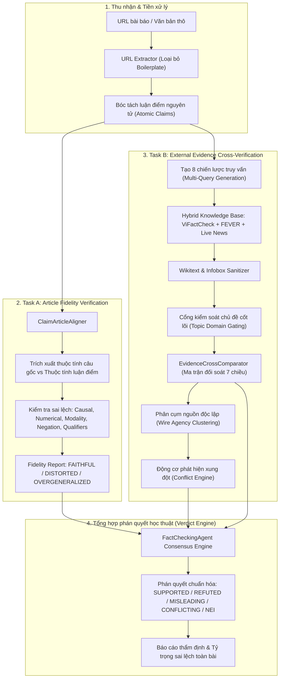

# TRUSTMEDIA AI — AI ARCHITECTURE & PIPELINE AUDIT REPORT

**Date:** 2026-11-24  
**Audit Scope:** End-to-End AI Pipelines, Model Inference, Feature Extractors, RAG Systems, Verdict Synthesis  
**System Version:** TrustMedia AI v1.2.0-Production  

---

## 1. High-Level AI Architecture Diagram

---

## 2. Core Verification Modules Breakdown

### 2.1. Module 1: Claim Extraction & Decomposition (`url_extractor.py` & `fact_checking_agent.py`)
- **Đầu vào:** Toàn văn bài báo, URL, tiêu đề bài báo.
- **Xử lý:**
  - Lọc văn bản hành chính: Giấy phép xuất bản, tổng biên tập, dấu tích xanh VnExpress, số điện thoại, điều khoản bản quyền.
  - Phân rã câu phức thành các mệnh đề sự kiện đơn nhất (Atomic Claims).
  - Gán nhãn phân loại thể loại: `FACTUAL_CLAIM`, `STATISTICAL_CLAIM`, `HISTORICAL_CLAIM`, `SCIENTIFIC_CLAIM`, `QUOTATION_CLAIM`, `CAUSAL_CLAIM`, `OPINION`, `PREDICTION`.
  - Loại bỏ các câu không thuộc phạm vi chủ đề của tiêu đề bài báo (`Title Anchor Filtering`).

### 2.2. Module 2: Article Fidelity Verification (`claim_article_aligner.py`)
- **Mục tiêu:** Bảo đảm hệ thống không làm biến dạng thông tin bài báo trước khi đi tìm chứng cứ.
- **Phương pháp:** Trích xuất có cấu trúc 11 trường dữ liệu (`ClaimAttributes`):
  `subject`, `predicate`, `object`, `value`, `unit`, `time`, `location`, `modality`, `causal_relation`, `negation`, `qualifiers`.
- **Cơ chế bắt lỗi:**
  - Đảo ngược phủ định (`NEGATION_REVERSAL`): Trừ 0.50 điểm tin cậy.
  - Đánh tráo tương quan thành nhân quả (`CAUSAL_DISTORTION`): Trừ 0.35 điểm.
  - Thổi phồng ngữ khí chắc chắn (`MODALITY_EXAGGERATION`): Trừ 0.25 điểm.
  - Bỏ sót điều kiện thí nghiệm in-vitro/chuột gán cho người (`OVERGENERALIZATION`): Trừ 0.30 điểm.

### 2.3. Module 3: Multi-Query Hybrid Retrieval & Sanitization (`hybrid_retrieval.py`)
- **Chiến lược truy vấn (8 strategies):**
  1. `exact`: Nguyên văn mệnh đề.
  2. `entity_focused`: Thực thể trọng tâm và địa danh.
  3. `numerical`: Thực thể kèm số liệu định lượng và đơn vị đo lường.
  4. `temporal`: Thực thể kèm mốc thời gian sự kiện.
  5. `primary_source`: Báo cáo chính phủ, cơ quan thẩm quyền, thông cáo chính thức.
  6. `supporting`: Khẳng định xác thực từ các nghiên cứu đồng thuận.
  7. `contradicting`: Bác bỏ, phản chứng, vạch trần tin đồn/lừa đảo.
  8. `original_research`: Nghiên cứu gốc, công bố khoa học độc lập.
- **Làm sạch dữ liệu:** Gỡ bỏ hoàn toàn mã thẻ MediaWiki, bảng thông tin infobox và các liên kết thô rác.
- **Cổng chủ đề (Domain Topic Gating):** Yêu cầu tối thiểu $\ge 30\%$ từ khóa chuyên môn để loại bỏ các tài liệu địa lý lạc đề.

### 2.4. Module 4: Claim–Evidence Cross-Verification (`evidence_cross_comparator.py`)
- **Đối soát 7 chiều:**
  - Thực thể chủ từ (`Subject Entity`).
  - Địa điểm thực thể (`Location Entity`).
  - Số liệu & Thống kê (`Numerical Value & Unit`).
  - Mốc thời gian (`Temporal Anchor`).
  - Quan hệ nhân quả & Ngữ khí (`Causality & Modality`).
  - Thuộc tính khẳng định / Phủ định (`Negation`).
  - Điều kiện ràng buộc (`Context Qualifiers`).
- **Phân cụm nguồn tin (`Wire Agency Clustering`):** Gom các bài viết dẫn nguồn TTXVN, Reuters, AFP về 1 cụm phụ thuộc.
- **Động cơ mâu thuẫn (`Conflict Engine`):** Ghi nhận trực tiếp sự bất đồng giữa các nguồn tin uy tín và chuyển sang trạng thái `CONFLICTING_EVIDENCE`.

### 2.5. Module 5: Verdict Engine (`fact_checking_agent.py`)
- Tổng hợp phán quyết khách quan theo IFCN Academic Standard v2.4:
  - `SUPPORTED`: Bằng chứng chứng minh đầy đủ luận điểm.
  - `REFUTED`: Bằng chứng bác bỏ trực tiếp phát ngôn.
  - `PARTIALLY_SUPPORTED`: Xác nhận một phần, phần còn lại chưa có căn cứ hoặc sai số liệu.
  - `MISLEADING`: Số liệu đúng nhưng diễn giải nhân quả hoặc phạm vi sai lệch.
  - `CONFLICTING_EVIDENCE`: Tồn tại tài liệu mâu thuẫn giữa các cơ quan độc lập.
  - `NOT_ENOUGH_INFORMATION`: Kho tri thức ngoại vi không đủ dữ liệu để khẳng định.
  - `NOT_CHECKABLE`: Ý kiến chủ quan, nhận định cảm tính hoặc dự báo tương lai.

