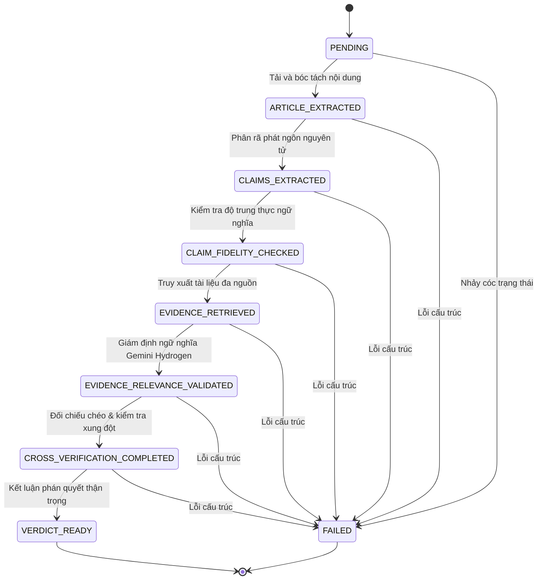

# MÁY TRẠNG THÁI KIỂM CHỨNG (VERIFICATION STATE MACHINE)
## TrustMedia AI — Core Scientific Verification Architecture

---

## 1. MỤC TIÊU VÀ NGUYÊN TẮC TOÀN VẸN

Máy trạng thái kiểm chứng (`ClaimVerificationStateMachine`) được xây dựng nhằm mục đích:
1. Đảm bảo quy trình thẩm định bài báo và từng phát ngôn tuân theo đồ thị trạng thái tuyến tính nghiêm ngặt.
2. Ngăn chặn tuyệt đối việc sinh phán quyết (verdict) khi chưa hoàn thành bước thu thập và giám định bằng chứng.
3. Thực thi nguyên tắc bảo lưu thận trọng (Conservative Abstention Policy) theo chuẩn quốc tế IFCN.

---

## 2. ĐỒ THỊ TRẠNG THÁI (STATE TRANSITION GRAPH)

### Chi tiết các trạng thái:
1. `PENDING`: Khởi tạo phiên thẩm định phát ngôn.
2. `ARTICLE_EXTRACTED`: Đã xác thực bài báo nguồn, tiêu đề, tác giả và ngày xuất bản.
3. `CLAIMS_EXTRACTED`: Đã phân tích cú pháp, trích xuất danh sách các claim kiểm chứng được.
4. `CLAIM_FIDELITY_CHECKED`: Đã so sánh claim trích xuất với câu gốc trong bài để loại bỏ bóp méo ngữ nghĩa.
5. `EVIDENCE_RETRIEVED`: Đã thực hiện truy xuất đa truy vấn (Multi-Query Retrieval) trên cơ sở tri thức báo chí.
6. `EVIDENCE_RELEVANCE_VALIDATED`: Đã qua bộ lọc của **Gemini 4 Hydrogen**, loại bỏ toàn bộ bằng chứng `IRRELEVANT`.
7. `CROSS_VERIFICATION_COMPLETED`: Đã chạy NLI, phân cụm nguồn độc lập và ma trận xung đột.
8. `VERDICT_READY`: Phán quyết cuối cùng được chuẩn hóa sẵn sàng trả về frontend và lưu database.
9. `FAILED`: Trạng thái sự cố khi xảy ra vi phạm đồ thị hoặc dữ liệu bất hợp lệ.

---

## 3. CƠ CHẾ BẢO LƯU THẬN TRỌNG (CONSERVATIVE ABSTENTION POLICY)

Phương thức `resolve_conservative_verdict()` áp dụng 6 quy tắc khoa học bất biến:

1. **Quy tắc 1 (Không có bằng chứng):** Nếu `valid_evidences` rỗng hoặc toàn bộ tài liệu bị gán nhãn `IRRELEVANT` -> Bắt buộc ra phán quyết `NOT_ENOUGH_INFORMATION`. Tuyệt đối không phỏng đoán.
2. **Quy tắc 2 (Bằng chứng yếu / diện rộng):** Tài liệu bối cảnh chỉ phản ánh chung chung không đủ để xác nhận hoặc bác bỏ luận điểm định lượng -> `NOT_ENOUGH_INFORMATION`.
3. **Quy tắc 3 (Xung đột nguồn độc lập):** Nếu tồn tại hai nguồn tin uy tín đối lập nhau trực tiếp -> `CONFLICTING_EVIDENCE`.
4. **Quy tắc 4 (Sai khác định lượng cùng chủ đề):** Sự kiện là có thật nhưng số liệu có sự chênh lệch (ví dụ: bài báo nói giảm 50%, nghiên cứu chỉ giảm 20%) -> Phán quyết `PARTIALLY_SUPPORTED` kèm chú giải sai lệch số liệu, không được gán nhãn `REFUTED`.
5. **Quy tắc 5 (Bác bỏ thực chứng):** Tồn tại văn bản kết luận chính thức hoặc hồ sơ khoa học phản bác trực tiếp luận điểm -> `REFUTED`.
6. **Quy tắc 6 (Xác thực đầy đủ):** Các tài liệu đối chứng độc lập xác thực toàn diện mệnh đề -> `SUPPORTED`.
